# Pagetrail

**AI Project Operations Agent — From project knowledge to coordinated execution.**

<div align="center">

[](https://pagetrail.onrender.com)
[](https://www.python.org/)
[](https://fastapi.tiangolo.com/)
[](https://react.dev/)
[](https://www.langchain.com/langgraph)
[](https://supabase.com/)

**Live Demo:** https://pagetrail.onrender.com  
**Repository:** https://github.com/sxb05/Pagetrail

</div>

---

## 01. Overview

Pagetrail is an AI-powered project operations workspace designed to help teams understand project information, coordinate tasks and monitor project execution.

It aims to transform scattered information across documents, meeting notes, conversations and development tools into actionable work through intelligent agents.

### Core Concept

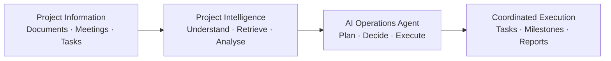

### Product Pillars

| Pillar | Purpose |
|---|---|
| Project Intelligence | Understand project requirements and documentation. |
| Task Coordination | Extract, organise, assign and track work. |
| Agentic Execution | Plan and execute multi-step operations using tools. |
| Project Monitoring | Identify overdue tasks, dependencies and blockers. |
| Automated Reporting | Generate project summaries and progress reports. |
| Integrations | Connect external applications and services. |

> **Development status:** The existing application provides document-grounded AI conversations, RAG, web search, persistent memory and conversation management. The Project Operations Agent, task management and external integrations are the next development milestones. Planned capabilities are not represented as completed features.

---

## 02. Current Features

The existing application provides the knowledge and conversational foundation for Pagetrail.

| Module | Implemented Functionality |
|---|---|
| Document Intelligence | PDF, DOCX, TXT and Markdown uploads and document-grounded conversations. |
| RAG Pipeline | Text extraction, chunking, embeddings and semantic retrieval. |
| AI Conversations | LangGraph-based conversational workflows using Gemini. |
| Web Search | Tavily-powered external information retrieval. |
| Long-term Memory | Persistent storage of information users explicitly ask the assistant to remember. |
| Authentication | Registration, login and bearer-token protected routes. |
| Conversation Management | Persistent messages and conversation history. |
| Agent Persistence | LangGraph PostgreSQL checkpointing. |
| Data Access | Application-level user ownership checks. |
| Deployment | FastAPI, React, Docker and Render. |

---

## 03. Project Operations Agent

The primary development direction is an AI agent that coordinates project execution rather than simply answering questions.

### Planned Capabilities

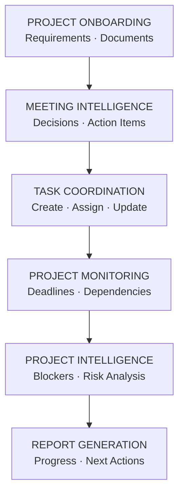

| Capability | Planned Function |
|---|---|
| Project Onboarding | Extract objectives, deliverables and requirements. |
| Meeting Intelligence | Convert meeting notes into structured action items. |
| Task Management | Generate, assign and update project tasks. |
| Dependency Tracking | Identify relationships and potential blockers. |
| Milestone Monitoring | Track deadlines and project deliverables. |
| Project Intelligence | Analyse progress and identify execution risks. |
| Report Generation | Produce DOCX and PDF progress reports. |
| External Integrations | Connect GitHub, Gmail and Google Calendar. |
| Human Approval | Request permission before sensitive actions. |

### Example: Project-to-Execution Workflow

**User instruction:**

"Review the project documents and meeting notes, identify pending activities, assign tasks and prepare a progress report."

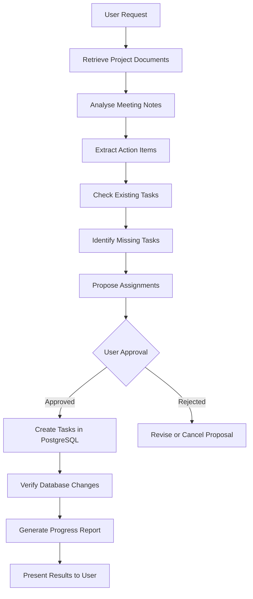

---

## 04. How the Agent Works

Pagetrail uses an orchestrated workflow in which the LLM determines what needs to happen, while application tools perform the actual operations.

### Agent Execution Lifecycle

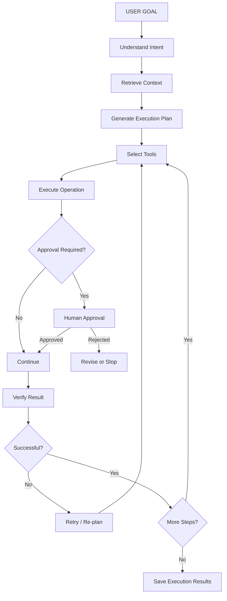

### Agent Components

| Component | Responsibility |
|---|---|
| Planner | Break user goals into executable steps. |
| Retriever | Retrieve project documents and existing data. |
| Tool Executor | Invoke application and external tools. |
| Approval Handler | Pause for user approval when necessary. |
| Verifier | Validate the result of each operation. |
| Execution Manager | Maintain state and execution history. |

**Design principle:** Use LLMs for reasoning and structured extraction. Use Python and SQL for deterministic operations, validation and database changes.

---

## 05. System Architecture

### A. Current Architecture

The existing system consists of a React frontend, FastAPI backend, LangGraph conversational workflow, Gemini and Supabase PostgreSQL.

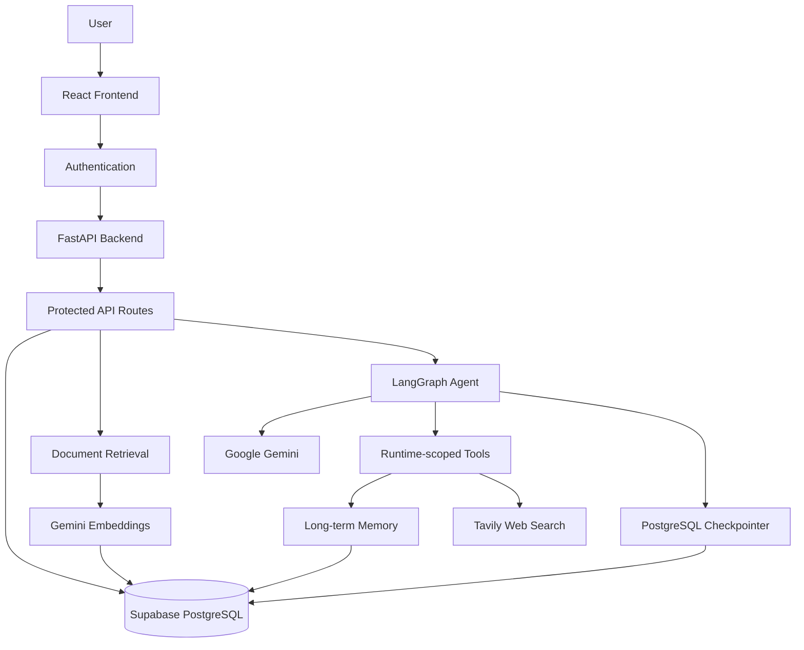

### B. Target Agent Architecture

The following is the proposed architecture for the Project Operations Agent.

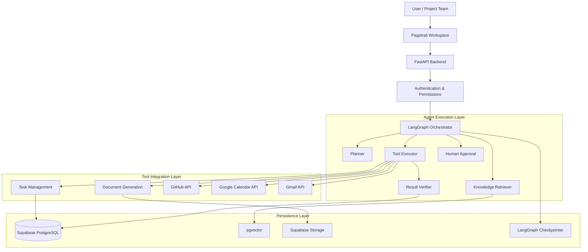

*The target architecture will be implemented incrementally. External integrations and project operations are planned additions.*

---

## 06. Technology Stack

### Current Stack

| Layer | Technology |
|---|---|
| Frontend | React 18, Vite, TypeScript |
| UI | Framer Motion, Lucide React |
| Backend | Python 3.11+, FastAPI, Uvicorn |
| Agent Framework | LangGraph, LangChain |
| LLM | Google Gemini |
| Embeddings | Gemini `gemini-embedding-001` |
| Database | Supabase PostgreSQL |
| ORM | SQLAlchemy |
| Vector Search | pgvector |
| Document Parsing | pypdf, docx2txt |
| Web Search | Tavily |
| State Persistence | LangGraph PostgreSQL Checkpointer, psycopg-pool |
| Guardrails | Guardrails AI |
| Containerization | Docker |
| Hosting | Render |

### Planned Additions

| Component | Technology | Purpose |
|---|---|---|
| Model Routing | Gemini Flash / Flash-Lite | Cost-aware model selection. |
| Background Jobs | Redis, Celery | Asynchronous and scheduled execution. |
| DOCX Generation | python-docx | Project reports and documents. |
| PDF Generation | ReportLab | Downloadable reports. |
| Spreadsheet Generation | openpyxl | Project trackers and reports. |
| Calendar | Google Calendar API | Meeting scheduling. |
| Email | Gmail API | Follow-ups and communication. |
| Development Tools | GitHub API | Issues, pull requests and repository activity. |
| Observability | LangSmith, Sentry | Agent tracing and error monitoring. |

---

## 07. Data Layer

### Current Data Model

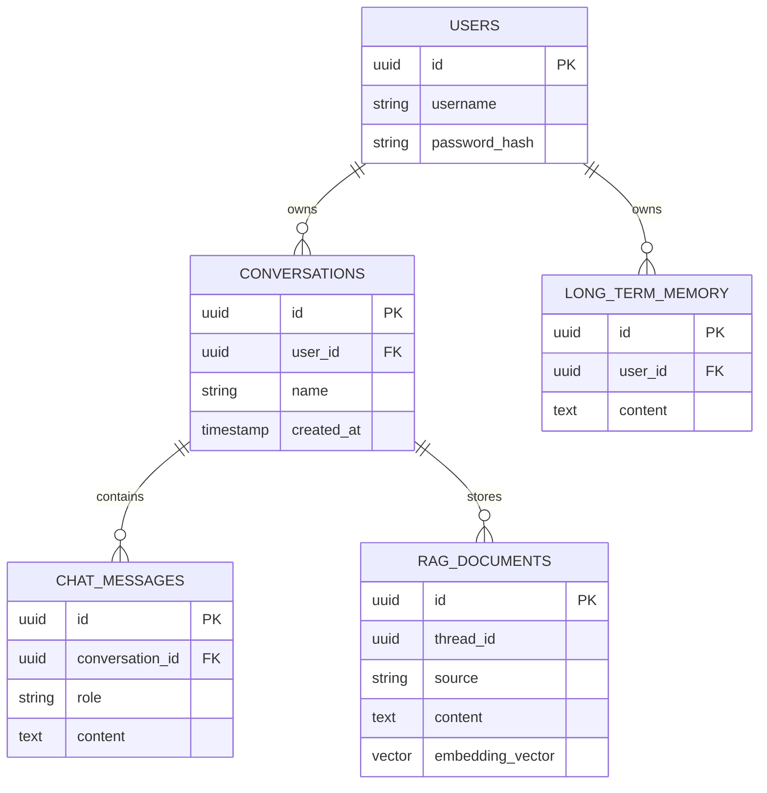

*Conceptual representation of the existing application data model; see the implementation for exact column definitions and relationships.*

### Document Retrieval Pipeline

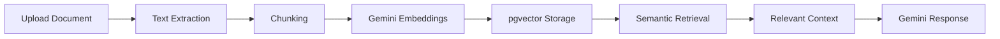

**Existing ingestion configuration:**

| Parameter | Configuration |
|---|---|
| Maximum upload size | 10 MB |
| Chunk size | 1,000 characters |
| Chunk overlap | 200 characters |
| Embedding model | `gemini-embedding-001` |
| Embedding dimension | 3,072 |
| Retrieval metric | Cosine distance |
| Storage | PostgreSQL pgvector |

Enable the PostgreSQL vector extension:

```sql
CREATE EXTENSION IF NOT EXISTS vector;
```

### Planned Project Data Model

The Operations Agent will introduce additional relational models:

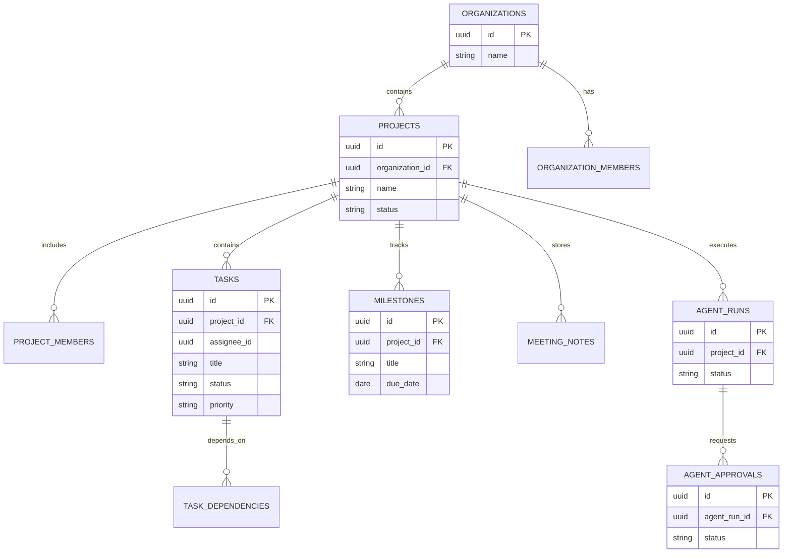

*Proposed domain model, not an existing database migration. Additional membership, audit and integration tables will be required.*

---

## 08. Project Structure

```text
Pagetrail/
│
├── backend/
│   ├── app/
│   │   ├── api/
│   │   │   └── routes/
│   │   ├── core/
│   │   ├── db/
│   │   ├── schemas/
│   │   ├── services/
│   │   ├── scripts/
│   │   └── main.py
│   │
│   ├── requirements.txt
│   └── tests/
│       ├── test_user_isolation.py
│       ├── test_document_routes.py
│       └── test_startup_safety.py
│
├── frontend/
│   ├── src/
│   │   ├── App.tsx
│   │   ├── Landing.tsx
│   │   ├── landing.css
│   │   └── styles.css
│   ├── index.html
│   └── vite.config.ts
│
├── Dockerfile
├── docker-compose.yaml
└── README.md
```

The structure represents the current repository at the time of documentation. Agent, project management and integration modules will be added as development progresses.

---

## 09. Getting Started

### Requirements

- Python 3.11+
- Node.js 18+
- npm
- Supabase PostgreSQL
- Google Gemini API key
- Tavily API key
- Docker (optional)

### Clone

```bash
git clone https://github.com/sxb05/Pagetrail.git
cd Pagetrail
```

### Backend Setup

**Windows:**

```powershell
python -m venv .venv
.venv\Scripts\Activate.ps1

pip install -r backend/requirements.txt
```

**Linux / macOS:**

```bash
python3 -m venv .venv
source .venv/bin/activate

pip install -r backend/requirements.txt
```

### Frontend Setup

```bash
npm --prefix frontend install
```

---

## 10. Environment Configuration

Create a `.env` file in the repository root.

```dotenv
# Database
DATABASE_URL=postgresql+psycopg://<user>:<password>@<host>:5432/<database>

DATABASE_HOST=<host>
DATABASE_PORT=5432
DATABASE_NAME=postgres
DATABASE_USERNAME=<user>
DATABASE_PASSWORD=<password>

# Optional admin connection
# DATABASE_ADMIN_URL=postgresql+psycopg://<admin>:<password>@<host>:5432/<database>

# Google Gemini
GEMINI_API_KEY=<gemini-api-key>

# Tavily
TAVILY_API_KEY=<tavily-api-key>

# Supabase
SUPABASE_URL=https://<project-ref>.supabase.co
SUPABASE_PUBLISHABLE_KEY=<publishable-key>
SUPABASE_SECRET_KEY=<server-side-secret>
SUPABASE_JWKS_URL=https://<project-ref>.supabase.co/auth/v1/.well-known/jwks.json

# Authentication
JWT_SECRET_KEY=<long-random-secret>
SECRET_KEY=<long-random-secret>
ALGORITHM=HS256
ACCESS_TOKEN_EXPIRE_MINUTES=30

# CORS
CORS_ORIGINS=http://localhost:5173,http://127.0.0.1:5173

# Guardrails
PAGETRAIL_GUARDRAILS=true
```

Never commit `.env` or expose server-side secrets in frontend code.

---

## 11. Running Locally

### Start Backend

```powershell
uvicorn app.main:app --reload --app-dir backend
```

Backend: `http://127.0.0.1:8000`

### Start Frontend

```powershell
npm --prefix frontend run dev
```

Frontend: `http://localhost:5173`

### Build Frontend

```powershell
npm --prefix frontend run build
```

---

## 12. Docker Deployment

```bash
docker compose up --build -d
```

View logs:

```bash
docker compose logs -f app
```

Stop:

```bash
docker compose down
```

The application is available at `http://localhost:8000`.

---

## 13. Database Initialization

Pagetrail deliberately keeps schema initialization outside the FastAPI startup lifecycle. This prevents database initialization from blocking the application from binding to its hosting port.

Run the initializer for a fresh database or when a release requires schema changes.

**Windows PowerShell:**

```powershell
$env:PYTHONPATH="backend"
python -m app.scripts.init_database
```

**Linux / macOS:**

```bash
PYTHONPATH=backend python -m app.scripts.init_database
```

**Render Shell:**

```bash
python -m app.scripts.init_database
```

The initializer:

1. Uses `DATABASE_ADMIN_URL` when configured, otherwise `DATABASE_URL`.
2. Verifies the PostgreSQL vector extension.
3. Creates the document retrieval table.
4. Creates application tables.
5. Applies the existing additive setup.
6. Exits non-zero when initialization fails.

Run it before deploying releases that depend on schema changes. Do not execute schema DDL inside Uvicorn startup or FastAPI lifespan.

### Health Endpoints

| Endpoint | Function |
|---|---|
| `/health/live` | HTTP process health. |
| `/health/ready` | PostgreSQL connectivity check. |

Use `/health/live` for the Render process health check. Use `/health/ready` to verify database readiness.

---

## 14. Testing

Run backend tests from the repository root.

```powershell
# User isolation
python -m pytest backend/tests/test_user_isolation.py -v

# Document routes
python -m pytest backend/tests/test_document_routes.py -v

# Startup safety
python -m pytest backend/tests/test_startup_safety.py -v
```

Run all tests:

```powershell
$env:PYTHONPATH="backend"
$env:PAGETRAIL_GUARDRAILS="false"

python -m pytest backend/tests -v
```

Agent execution, tool permissions, approval workflows and task operations will require additional tests as they are implemented.

---

## 15. Security and Reliability

### Current Security Status

- Application-level conversation ownership checks.
- User-scoped document retrieval.
- Memory ownership validation.
- User and conversation context passed through `ToolRuntime`.
- User-specific checkpoint namespaces.
- Server-side credential management.
- Upload size restrictions.

> **Important: Production Row-Level Security is incomplete.** RLS is enabled on the five existing application tables, but zero policies are configured and the current backend role has `BYPASSRLS = true`. Database-level row isolation is therefore not enforced. Do not claim production-grade multi-tenant isolation until policies and least-privileged database access are implemented and verified.

### Planned Agent Guardrails

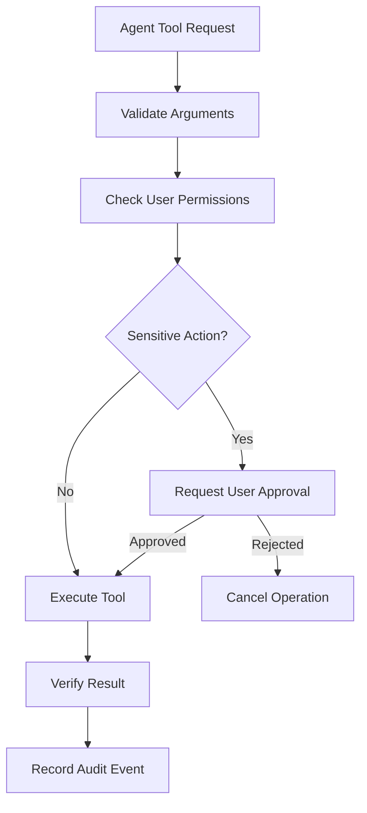

Planned reliability controls:

- Input validation and structured tool schemas.
- Project-level access control.
- Human approval for sensitive actions.
- Audit logging.
- Prompt-injection protection.
- Execution timeouts and retry limits.
- Idempotent tool operations.
- Workflow persistence and recovery.

---

## 16. Deployment and Troubleshooting

**Production demo:** https://pagetrail.onrender.com

### Deployment Checklist

1. Push reviewed changes to GitHub.
2. Configure the Render Docker service.
3. Set required environment variables.
4. Verify Supabase connectivity.
5. Confirm `pgvector` is enabled.
6. Run database initialization when required.
7. Configure `/health/live`.
8. Verify `/health/ready` after deployment.

### Common Issues

| Error | Possible Cause | Fix |
|---|---|---|
| Out-of-memory crash | Guardrails ML models | Set `PAGETRAIL_GUARDRAILS=false` on low-memory instances. |
| No open ports detected | Startup exception or OOM | Inspect early deployment logs and verify port binding. |
| Embedding failure | Missing Gemini key | Verify `GEMINI_API_KEY`. |
| Web search failure | Tavily key issue | Verify `TAVILY_API_KEY`. |
| Frontend 503 | Missing production build | Rebuild Docker image. |
| Database connection failure | Incorrect URL or credentials | Verify Supabase connection settings. |

### Low-Memory Hosting

On instances with approximately 512 MB RAM, use:

```dotenv
PAGETRAIL_GUARDRAILS=false
```

With lazy imports, this avoids loading the optional ML detector packages into the web process during startup.

Regex-based jailbreak checks remain active, but ML-based jailbreak classification and ML-based PII redaction are skipped.

This reduces memory consumption but provides less protection than the complete ML-based configuration.

---

## 17. Development Roadmap

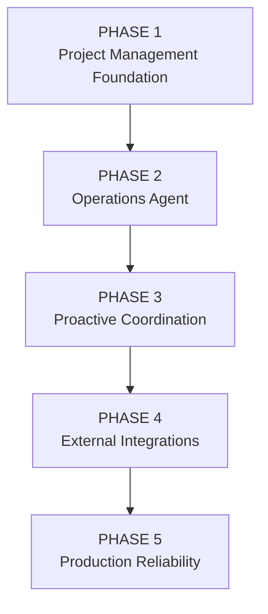

### Phase 1 — Project Management Foundation

- [ ] Projects and workspaces.
- [ ] Team membership and roles.
- [ ] Task creation and assignment.
- [ ] Task status and priorities.
- [ ] Milestones and dependencies.
- [ ] Project dashboard.

### Phase 2 — Project Operations Agent

- [ ] LangGraph operations orchestrator.
- [ ] Project context retrieval.
- [ ] Meeting-note analysis.
- [ ] Action-item extraction.
- [ ] Structured task generation.
- [ ] Tool execution.
- [ ] Human approval workflows.
- [ ] Document and progress report generation.

### Phase 3 — Proactive Coordination

- [ ] Background job execution.
- [ ] Scheduled project monitoring.
- [ ] Overdue task detection.
- [ ] Dependency and blocker analysis.
- [ ] Automated progress reports.
- [ ] Workflow recovery and verification.

### Phase 4 — Integrations

- [ ] GitHub API.
- [ ] Google Calendar API.
- [ ] Gmail API.
- [ ] External notifications.
- [ ] Cross-application workflows.

### Phase 5 — Production Reliability

- [ ] PostgreSQL RLS policies.
- [ ] Least-privileged database access.
- [ ] Cross-user isolation testing.
- [ ] Agent execution evaluations.
- [ ] Cost and latency monitoring.
- [ ] Integration credential management.
- [ ] Audit logging.
- [ ] Background worker deployment.

---

## 18. Contributing

Contributions and feedback are welcome.

1. Fork the repository.
2. Create a feature branch.
3. Implement and test changes.
4. Submit a pull request with a clear description.

Please do not commit API keys, environment files, database credentials or user data.

---

## Author

**Subash Balaji**

- GitHub: [@sxb05](https://github.com/sxb05)
- Repository: [Pagetrail](https://github.com/sxb05/Pagetrail)
- Live Application: [pagetrail.onrender.com](https://pagetrail.onrender.com)

---

**Pagetrail — Turning project knowledge into coordinated execution.**
