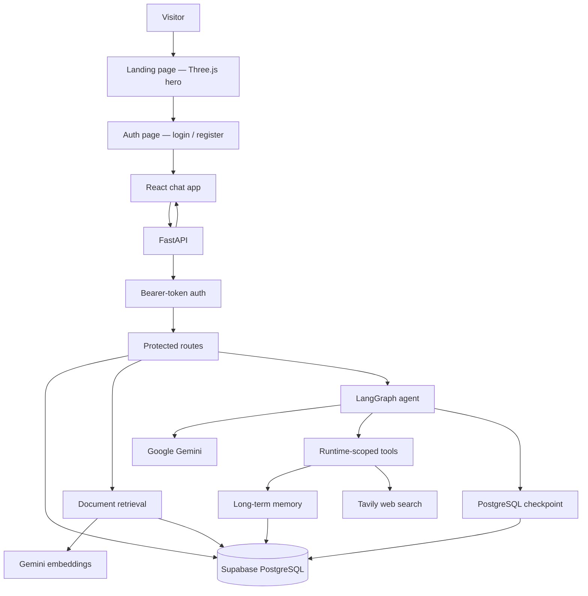

# PageTrail

**Document-aware AI chat with retrieval, web search, and long-term memory.**

<div align="center">

[](https://pagetrail.onrender.com)
[](https://www.python.org/)
[](https://fastapi.tiangolo.com/)
[](https://react.dev/)
[](https://threejs.org/)
[](https://supabase.com/)

**Live demo:** [pagetrail.onrender.com](https://pagetrail.onrender.com)  
**Source code:** [github.com/sxb05/Pagetrail](https://github.com/sxb05/Pagetrail)

</div>

PageTrail is a full-stack AI application built with **FastAPI, React, TypeScript, LangGraph, LangChain, Google Gemini, Three.js, and Supabase PostgreSQL**. It features a WebGL landing page with a rotating glass cuboid, document-grounded conversations, optional web search, persistent conversation history, and long-term memory.

> **Development status:** Application-level user-isolation improvements and a focused set of regression tests are in progress. Production database Row-Level Security (RLS) is **not yet fully configured or verified**. See [Security and user-isolation status](#security-and-user-isolation-status) before treating this as production-hardened.

---

## Contents

- [Features](#features)
- [Technology stack](#technology-stack)
- [Architecture](#architecture)
- [Data model and retrieval](#data-model-and-retrieval)
- [Security and user-isolation status](#security-and-user-isolation-status)
- [Project structure](#project-structure)
- [Requirements](#requirements)
- [Local setup](#local-setup)
- [Environment configuration](#environment-configuration)
- [Run locally](#run-locally)
- [Docker Compose](#docker-compose)
- [Tests](#tests)
- [Deployment and troubleshooting](#deployment-and-troubleshooting)
- [Memory and OOM fix](#memory-and-oom-fix)
- [Roadmap](#roadmap)
- [Author](#author)

## Features

- **Glass-cuboid hero landing page:** Three.js WebGL scene with a custom GLSL refraction shader — 6-band chromatic dispersion, Fresnel edges, two-pass render pipeline, drag-to-rotate with inertia and idle drift. Falls back gracefully when WebGL is unavailable.
- **Document-aware chat:** Ask questions about uploaded PDF, DOCX, TXT, and Markdown files.
- **Retrieval-Augmented Generation (RAG):** Extract document text, split into chunks, embed with Gemini, store in pgvector, retrieve by cosine distance.
- **Web search:** Tavily search tool for queries that need online information.
- **Long-term memory:** Store information users explicitly ask the assistant to remember.
- **Authentication:** Register and sign in with username/password credentials; protected routes use a bearer token.
- **Conversation history:** Persist conversations and messages in PostgreSQL.
- **User-scoped access:** Conversation operations and document/memory retrieval include ownership checks.
- **Persistent agent state:** LangGraph PostgreSQL checkpointer preserves state between requests.
- **Full-stack delivery:** React/Vite frontend served by the FastAPI backend in production.
- **Containerized deployment:** Multi-stage Docker build (Node frontend → Python backend image).
- **Collapsible sidebar:** Smooth flex-basis collapse (no negative-margin layout shift); remembers state across sessions.

## Technology stack

| Layer | Technology |
|---|---|
| Landing page | Three.js r169, custom GLSL glass shader, `RoundedBoxGeometry`, `GLTFLoader` |
| Frontend | React 18, Vite, TypeScript, Framer Motion, Lucide React |
| API | Python 3.11+, FastAPI, Uvicorn |
| Agent orchestration | LangGraph, LangChain |
| Chat model | Google Gemini via `langchain-google-genai` |
| Embeddings | Google Gemini embeddings (`gemini-embedding-001`) |
| Database | Supabase PostgreSQL, SQLAlchemy, Psycopg |
| Vector representation | `pgvector` `Vector(3072)` cosine-distance |
| Document parsing | `pypdf`, `docx2txt`, text/Markdown |
| Web search | Tavily |
| State persistence | LangGraph PostgreSQL checkpointer + `psycopg-pool` |
| Input/output safety | Guardrails AI jailbreak and PII checks (ML-optional — see [Memory and OOM fix](#memory-and-oom-fix)) |
| Hosting | Render |

## Architecture



### Chat request lifecycle

1. The frontend sends a message and conversation ID.
2. The backend resolves the authenticated user from the bearer token.
3. Conversation ownership is verified; the user message is saved.
4. Document retrieval is scoped to the conversation and owning user.
5. LangGraph invokes the chat model and tools with user/conversation context in `ToolRuntime`.
6. The assistant response is saved and returned.

## Data model and retrieval

| Table | Purpose |
|---|---|
| `users` | Usernames and password hashes |
| `conversations` | Conversation ID, owner, name, timestamps |
| `chat_messages` | Messages associated with a conversation and user |
| `long_term_memory` | Memories scoped to conversation and user |
| `rag_documents` | Document chunks, source names, and pgvector embeddings |

**Document ingestion:** 10 MB limit, 1,000-char chunks / 200-char overlap, Gemini embeddings stored in `Vector(3072)`. Retrieval filters by `thread_id` and `user_id` before cosine-distance ranking.

> **Extension note:** The database must have the `vector` PostgreSQL extension enabled (`CREATE EXTENSION IF NOT EXISTS vector;` in Supabase SQL editor).

## Security and user-isolation status

### Application-level hardening

- Conversation listing, history, and deletion filter by `user_id`.
- Document retrieval joins conversations and filters by owner.
- Memory reads and writes verify conversation ownership.
- Agent tools receive `user_id` and `thread_id` via `ToolRuntime` (no shared global).
- Checkpoint IDs are namespaced as `user:<id>:conversation:<id>`.

### Test evidence

Eight isolation tests pass in `backend/tests/test_user_isolation.py`:

```powershell
python -m pytest backend/tests/test_user_isolation.py -v
```

### Production RLS is incomplete

RLS is enabled on all five tables but **zero policies are configured** and the backend role has `BYPASSRLS = true`. Database-level row isolation is not enforced. Do not claim production multi-tenant isolation until policies and a least-privileged runtime role are tested end-to-end.

## Project structure

```text
Pagetrail/
├── backend/
│   ├── app/
│   │   ├── api/routes/       # auth, chat/conversations/files, health
│   │   ├── core/             # settings and paths
│   │   ├── db/               # SQLAlchemy models and session helpers
│   │   ├── schemas/          # Pydantic schemas
│   │   ├── services/         # agent, RAG, guardrails, LangGraph tools
│   │   └── main.py           # FastAPI app and startup
│   ├── requirements.txt
│   └── tests/
│       ├── test_user_isolation.py
│       ├── test_document_routes.py
│       └── test_startup_safety.py
├── frontend/
│   ├── src/
│   │   ├── App.tsx            # Main chat app (auth-gated)
│   │   ├── Landing.tsx        # Three.js glass-cuboid hero
│   │   ├── landing.css        # Hero styles (Poppins, scoped)
│   │   └── styles.css         # Chat app styles
│   ├── index.html
│   └── vite.config.ts
├── Dockerfile                  # Multi-stage: Node build → Python runtime
├── docker-compose.yaml
└── README.md
```

## Requirements

- Python 3.11+
- Node.js 18+ and npm
- Supabase PostgreSQL project with the `vector` extension enabled
- Google Gemini API key
- Tavily API key (for web search)
- Docker and Docker Compose (for the containerized workflow)

## Local setup

### 1. Clone

```bash
git clone https://github.com/sxb05/Pagetrail.git
cd Pagetrail
```

### 2. Install backend dependencies

```powershell
# Windows (Conda)
conda activate multi-agents
pip install -r backend/requirements.txt

# or venv
python -m venv .venv
.venv\Scripts\Activate.ps1
pip install -r backend/requirements.txt
```

```bash
# Linux / macOS
python3 -m venv .venv && source .venv/bin/activate
pip install -r backend/requirements.txt
```

### 3. Install frontend dependencies

```powershell
npm --prefix frontend install
```

## Environment configuration

Create a `.env` file in the repository root. Never commit it.

```dotenv
# PostgreSQL (Supabase → Project Settings → Database → Connection string)
DATABASE_URL=postgresql+psycopg://<user>:<password>@<host>:5432/<database>
DATABASE_HOST=<host>
DATABASE_PORT=5432
DATABASE_NAME=postgres
DATABASE_USERNAME=<user>
DATABASE_PASSWORD=<password>

# Optional separate admin connection (for future RLS/least-privilege work)
# DATABASE_ADMIN_URL=postgresql+psycopg://<admin>:<password>@<host>:5432/<database>

GEMINI_API_KEY=<gemini-api-key>
TAVILY_API_KEY=<tavily-api-key>

SUPABASE_URL=https://<project-ref>.supabase.co
SUPABASE_PUBLISHABLE_KEY=<publishable-key>
SUPABASE_SECRET_KEY=<server-side-secret>
SUPABASE_JWKS_URL=https://<project-ref>.supabase.co/auth/v1/.well-known/jwks.json

JWT_SECRET_KEY=<long-random-secret>
SECRET_KEY=<long-random-secret>
ALGORITHM=HS256
ACCESS_TOKEN_EXPIRE_MINUTES=30

CORS_ORIGINS=http://localhost:5173,http://127.0.0.1:5173

# Safety: set to false on hosting plans with ≤ 512 MB RAM to skip
# the transformer models (regex-only checks remain active).
PAGETRAIL_GUARDRAILS=true
```

## Run locally

### Backend

```powershell
uvicorn app.main:app --reload --app-dir backend
```

Health endpoints: `http://127.0.0.1:8000/health/live` and `http://127.0.0.1:8000/health/ready` (the legacy `/api/health` path remains available).

### Frontend

```powershell
npm --prefix frontend run dev
```

Vite dev server: `http://localhost:5173`

### Production frontend build

```powershell
npm --prefix frontend run build
```

## Docker Compose

```powershell
docker compose up --build -d
docker compose logs -f app
```

Open `http://localhost:8000`. To stop:

```powershell
docker compose down
```


## Database initialization and Render deployment

PageTrail deliberately does **not** run schema DDL in the FastAPI startup hook. Uvicorn can bind to Render's assigned port without waiting for Supabase migrations, and a database outage is reported by readiness checks instead of preventing the HTTP listener from starting.

Run the schema initializer once for a fresh database, and again when a release includes database/schema changes. It is safe to rerun: it creates missing tables and applies the existing additive column/RLS setup; it does not drop tables or delete application records.

From the repository root on Windows PowerShell:

```powershell
$env:PYTHONPATH="backend"
python -m app.scripts.init_database
```

From the repository root on Linux/macOS:

```bash
PYTHONPATH=backend python -m app.scripts.init_database
```

For a deployed Render Docker service, run this from the service Shell:

```bash
python -m app.scripts.init_database
```

The command uses the configured `DATABASE_ADMIN_URL` when present, otherwise the existing `DATABASE_URL` fallback. It first verifies that the PostgreSQL `vector` extension is enabled, creates `rag_documents`, then creates the application tables and applies the current additive setup. It logs and exits non-zero on any failure; it never suppresses migration errors.

**Deployment sequence:** run the database command before switching traffic to a release that requires schema changes. If the Render plan/service supports a pre-deploy command, configure `python -m app.scripts.init_database` there. Otherwise run it manually from the Render Shell before deploying that release. Do not put it back in the Uvicorn CMD or FastAPI lifespan.

### Health endpoints

- `GET /health/live` (also available at the backwards-compatible `GET /api/health`) confirms that the HTTP process is running and does not require PostgreSQL.
- `GET /health/ready` runs a bounded `SELECT 1` against PostgreSQL and returns HTTP 503 when the database cannot be reached.

Use `/health/live` as Render's process/port health-check path so a temporary database outage does not get mistaken for a server that failed to bind its port. Use `/health/ready` when you specifically need to confirm database readiness.

The application connection pool is intentionally small for low-memory hosting, and PostgreSQL connection establishment is bounded by a five-second timeout.

## Tests

```powershell
# User isolation (8 tests)
python -m pytest backend/tests/test_user_isolation.py -v

# Document routes (4 tests)
python -m pytest backend/tests/test_document_routes.py -v

# Startup and health-check regression tests
python -m pytest backend/tests/test_startup_safety.py -v

# All backend tests (run with lightweight regex-only guardrails)
$env:PYTHONPATH="backend"; $env:PAGETRAIL_GUARDRAILS="false"; python -m pytest backend/tests -v
```

## Deployment and troubleshooting

PageTrail is hosted at [pagetrail.onrender.com](https://pagetrail.onrender.com).

### Deployment checklist

1. Push reviewed changes to the repository.
2. Configure a Render Web Service or use the Docker setup.
3. Set all required environment variables in the hosting dashboard.
4. **On Render free/starter (512 MB RAM): set `PAGETRAIL_GUARDRAILS=false`** — see below.
5. Verify database connectivity and confirm `pgvector` is enabled.
6. Configure Render's health-check path as `/health/live`.
7. After deployment, verify `/health/ready` returns `200` when Supabase is reachable.

### Common failures

| Symptom | Likely cause | Fix |
|---|---|---|
| OOM crash at startup / `used over 512Mi` | Guardrails ML models load ~350 MB | Set `PAGETRAIL_GUARDRAILS=false` in Render env vars |
| No open port detected | Import/startup exception, container OOM, or a blocking startup hook | Inspect the first traceback/OOM message; verify required database settings and keep schema initialization out of FastAPI startup |
| Embedding failure | `GEMINI_API_KEY` missing | Add to hosting env |
| Web search failure | `TAVILY_API_KEY` not loaded | Verify env var and `tools.py` |
| Frontend 503 | `frontend/dist` missing | Rebuild Docker image |
| Data isolation regression | Ownership check missing | Rerun isolation tests |

## Memory and OOM fix

**Memory note:** The optional Guardrails ML detectors can consume substantial memory when first invoked. They are now imported lazily, so with `PAGETRAIL_GUARDRAILS=false` the detector packages are not imported into the web process during startup. On a 512 MB instance, keep the flag set to false. Explicit regex jailbreak checks remain active; ML jailbreak classification and ML-based PII redaction are skipped.

This memory issue can cause an out-of-memory termination if ML detectors are enabled on a small instance, but it should not be assumed to be the cause of every `No open ports detected` deployment. Confirm the first Render error or `used over 512Mi` message in the deployment logs.

**Recommended setting for a 512 MB instance:**

```
PAGETRAIL_GUARDRAILS=false
```

With the lazy imports, this also avoids importing the ML detector libraries during application startup. The regex-based jailbreak patterns (`ignore all previous instructions`, `reveal your system prompt`, etc.) **remain active regardless** of this setting. The tradeoff is reduced coverage of novel/obfuscated jailbreak attempts and no ML-based PII redaction.

For production deployments on plans with ≥ 1 GB RAM, keep `PAGETRAIL_GUARDRAILS=true` (the default) to retain full ML-based safety.

**Other memory savings already applied:**

- Removed `streamlit` from `requirements.txt` (was unused; pulled in numpy, pandas, etc. ≈ 150 MB)
- Added `uvicorn[standard]` with a single worker (`--workers 1`) in the Dockerfile CMD
- Three.js is code-split into a separate browser chunk (`three-*.js`) and never loaded server-side

## Roadmap

- [ ] Finish PostgreSQL RLS policies and least-privileged runtime role.
- [ ] Add PostgreSQL/pgvector integration tests and real checkpointer isolation tests.
- [ ] Add API-level cross-user tests with authenticated test clients.
- [ ] Ensure the Tavily tool reads its key from application configuration.
- [ ] Remove the development JWT-secret fallback.
- [ ] Add CI for tests, linting, and build checks.
- [ ] Add RAG evaluation for retrieval relevance and answer faithfulness.
- [ ] Consider streaming responses, background document ingestion, and semantic caching.
- [ ] Upgrade to Render Standard (512 MB → 2 GB) to re-enable full ML guardrails without the flag.

## Security practices

- Never commit `.env`, tokens, API keys, database credentials, or user content.
- Keep server-side credentials out of frontend code.
- Set a strong `JWT_SECRET_KEY` for every deployed environment.
- Validate uploads and enforce size limits.
- Retain owner checks in application queries even after RLS is introduced.
- Test PostgreSQL policies with the same role and connection path used by the deployed app.

## Author

**Subash Balaji**

- GitHub: [@sxb05](https://github.com/sxb05)
- Repository: [Pagetrail](https://github.com/sxb05/Pagetrail)
- Live app: [pagetrail.onrender.com](https://pagetrail.onrender.com)
