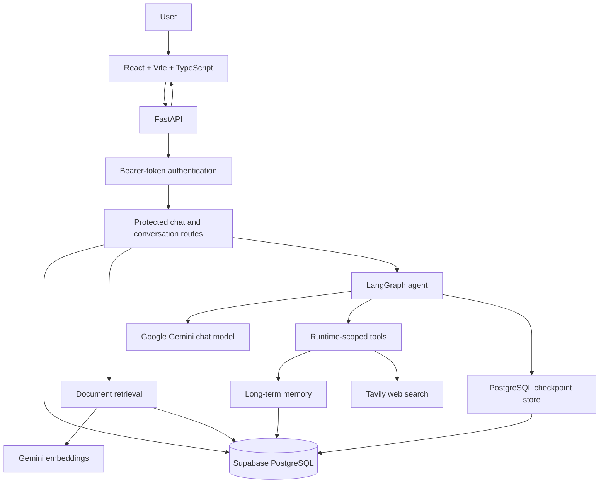

# PageTrail

**Document-aware AI chat with retrieval, web search, and long-term memory.**

<div align="center">

[](https://pagetrail.onrender.com)
[](https://www.python.org/)
[](https://fastapi.tiangolo.com/)
[](https://react.dev/)
[](https://supabase.com/)

**Live demo:** [pagetrail.onrender.com](https://pagetrail.onrender.com)  
**Source code:** [github.com/sxb05/Pagetrail](https://github.com/sxb05/Pagetrail)

</div>

PageTrail is a full-stack AI application built with **FastAPI, React, TypeScript, LangGraph, LangChain, Google Gemini, and Supabase PostgreSQL**. It supports document-grounded conversations, optional web search, persistent conversation history, and long-term memory for information a user asks the assistant to remember.

> **Development status:** Application-level user-isolation improvements and a focused set of regression tests are in progress. The current working tree has eight passing isolation tests, but production database Row-Level Security (RLS) is **not yet fully configured or verified**. See [Security and user-isolation status](#security-and-user-isolation-status) before treating this implementation as production-hardened.

---

## Contents

- [Features](#features)
- [Technology stack](#technology-stack)
- [Architecture](#architecture)
- [Data model and retrieval](#data-model-and-retrieval)
- [Security and user-isolation status](#security-and-user-isolation-status)
- [Project structure](#project-structure)
- [Requirements](#requirements)
- [Local setup](#local-setup)
- [Environment configuration](#environment-configuration)
- [Run locally](#run-locally)
- [Docker Compose](#docker-compose)
- [Tests](#tests)
- [Deployment and troubleshooting](#deployment-and-troubleshooting)
- [Roadmap](#roadmap)
- [Author](#author)

## Features

- **Document-aware chat:** Ask questions about uploaded PDF, DOCX, TXT, and Markdown files.
- **Retrieval-Augmented Generation (RAG):** Extract document text, split it into chunks, create embeddings, and place retrieved content into the model context.
- **Web search:** Includes a Tavily search tool for queries that need online information.
- **Long-term memory:** Store information users explicitly ask the assistant to remember and search memories later.
- **Authentication:** Register and sign in with username/password credentials; protected routes use a bearer token.
- **Conversation history:** Persist conversations and messages in PostgreSQL.
- **User-scoped access checks:** Conversation operations and the current document/memory retrieval paths include application-level ownership checks.
- **Persistent agent state:** LangGraph uses a PostgreSQL checkpointer to preserve state between requests.
- **Full-stack delivery:** React/Vite frontend and FastAPI backend; the production frontend can be served by the backend.
- **Containerized deployment:** Docker builds the frontend and backend; Docker Compose also starts a Redis service.

## Technology stack

| Layer | Technology |
|---|---|
| Frontend | React, Vite, TypeScript |
| API | Python 3.11+, FastAPI, Uvicorn |
| Agent orchestration | LangGraph, LangChain |
| Chat model | Google Gemini through `langchain-google-genai` |
| Embeddings | Google Gemini embeddings (`gemini-embedding-001`) |
| Database | Supabase PostgreSQL, SQLAlchemy, Psycopg |
| Vector representation | `pgvector` `Vector(3072)` column; JSON embedding field is also retained |
| Document parsing | `pypdf`, `docx2txt`, text/Markdown file reading |
| Web search | Tavily tool integration |
| State persistence | LangGraph PostgreSQL checkpointer |
| Hosting | Render |
| Local containers | Docker, Docker Compose, Redis service |

## Architecture



### Chat request lifecycle

1. The frontend sends a message and conversation ID to the FastAPI backend.
2. The backend resolves the authenticated user from the bearer token.
3. The chat route verifies/updates conversation ownership and saves the user's message.
4. Document retrieval is scoped to the requested conversation and its owning user; retrieved excerpts can be inserted into the prompt.
5. LangGraph invokes the chat model and available tools. The current local hardening changes pass user and conversation context through invocation configuration rather than a shared global conversation variable.
6. The assistant response is saved and returned to the frontend.

## Data model and retrieval

The application uses these PostgreSQL tables:

| Table | Purpose |
|---|---|
| `users` | Usernames and password hashes |
| `conversations` | Conversation ID, owner, name, and timestamps |
| `chat_messages` | User and assistant messages associated with a conversation and user |
| `long_term_memory` | Memories associated with a conversation; the current model includes a `user_id` field |
| `rag_documents` | Document chunks, source names, and embeddings |

### Document ingestion and retrieval

1. The user selects a PDF, DOCX, TXT, or Markdown file in the composer.
2. The backend validates the file extension and enforces a 10 MB upload limit.
3. Text is extracted and split into chunks with a 1,000-character chunk size and 200-character overlap.
4. Gemini embeddings are generated and stored with each chunk.
5. Retrieval filters chunks by `thread_id` and joins the conversation table to filter by `Conversation.user_id` before ranking results.
6. The query uses cosine distance over the `embedding_vector` column and returns the top results.

**PostgreSQL extension note:** The current RAG schema uses `pgvector.sqlalchemy.Vector(3072)` and the query uses `cosine_distance`. The database must have the PostgreSQL `vector` extension available for this implementation. An older README statement that PageTrail does not require the extension is no longer accurate for the current local implementation. Confirm the extension is enabled in the target database before deploying these retrieval changes.

The table also retains an `embedding` JSON-text field alongside `embedding_vector`; don't assume the JSON column is the only representation used for ranking.

## Security and user-isolation status

### Application-level changes in the current working tree

The following changes have been made and tested locally during the current hardening effort:

- **Conversation ownership:** Conversation updates, listing, history, and deletion use the authenticated user's ID in their database paths.
- **Message isolation:** Chat history filters by both `thread_id` and `user_id`.
- **Document retrieval scoping:** Retrieval joins `rag_documents` to `conversations` and filters by the conversation's owner before returning chunks.
- **Memory write checks:** `save_memory(thread_id, user_id, content)` verifies that the conversation belongs to the supplied user before inserting a memory.
- **Memory search scoping:** `search_memory(thread_id, user_id, query)` filters by both thread and user. `LongTermMemory` includes a nullable `user_id` column for compatibility with existing records.
- **Request-scoped agent context:** The shared `CURRENT_THID` global was removed from the local implementation. Tools obtain `conversation_thread_id` and `user_id` from LangGraph's `ToolRuntime` configuration.
- **Checkpoint ID namespacing:** The chat route builds checkpoint IDs in the form `user:<user_id>:conversation:<conversation_id>` so different users don't get the same checkpoint key merely by presenting the same conversation ID.
- **Lazy embedding client initialization:** The RAG module initializes/caches the Gemini embedding client only when needed, rather than issuing a test embedding request at module import time.
- **Administrative-engine scaffold:** `DATABASE_ADMIN_URL` and `admin_engine` have been introduced for schema initialization. If `DATABASE_ADMIN_URL` is unset, the current implementation falls back to `DATABASE_URL`; this is not yet privilege separation until a distinct administrative connection is configured.

### Current automated test evidence

The current local suite is `backend/tests/test_user_isolation.py`. The last reported run completed with **8 passed**. Run it using:

```powershell
cd backend
python -m pytest tests/test_user_isolation.py -v
```

The tests cover:

- A user cannot access another user's conversation through the ownership helper.
- Conversation listing is scoped to the user.
- Message history is scoped to the user.
- Memory search is scoped to the user.
- A user cannot save a memory into another user's conversation.
- A user can save and search their own memory.
- Document retrieval only returns documents for the owning user.
- The checkpoint ID helper creates distinct IDs for different users and stable IDs for the same user/conversation pair.

These results are useful regression evidence, not a complete security certification. The document test uses an in-memory SQLite database and mocks the embedding call and pgvector cosine-distance expression. The checkpoint test verifies the ID-building helper; it does not exercise a real PostgreSQL checkpointer end to end.

### Production RLS is still incomplete

A check of the configured Supabase database during this hardening session found:

- RLS was enabled on `users`, `conversations`, `chat_messages`, `long_term_memory`, and `rag_documents`.
- The inspected schema returned zero policies for those five tables.
- The database role used by the backend reported `BYPASSRLS = true`.
- The newly introduced `pagetrail_app` role was created as `NOLOGIN` and `NOBYPASSRLS`, but it has not been configured as the application's active role.

Therefore, **database-level RLS is not currently enforcing per-user access for the backend connection**. Application-level filters should remain in place, but they are not a replacement for a correctly configured, least-privileged database role and tested RLS policies.

Before treating the app as production-hardened, complete and verify all of the following:

1. Create and test RLS policies for each relevant table.
2. Define a trustworthy per-request database user context that corresponds to the authenticated PageTrail user.
3. Configure and test a restricted runtime role that cannot bypass RLS, while keeping schema migrations on a separate administrative connection.
4. Verify authorization for the LangGraph PostgreSQL checkpoint store as well as the application tables.
5. Run integration tests against PostgreSQL/pgvector, including concurrent requests and cross-user access attempts.
6. Confirm that legacy records with nullable ownership are handled safely.

Do not configure `DATABASE_URL` to use the restricted role until the required policies, permissions, and user-context plumbing have been implemented and tested. The administrative connection currently falls back to the application URL when `DATABASE_ADMIN_URL` is not set.

### Other release-readiness notes

- The reviewed `tools.py` still contains a placeholder assignment for `TAVILY_API_KEY`; verify that the tool loads the actual environment value before relying on Tavily in deployment.
- The authentication module reads `JWT_SECRET_KEY` directly and has a development-only fallback. Set a strong `JWT_SECRET_KEY` in every deployed environment and remove/fail fast on the fallback before production use. The `SECRET_KEY` setting is not automatically a substitute for `JWT_SECRET_KEY` in that module.
- Never commit `.env`, database credentials, API keys, user data, or generated local artifacts.

## Project structure

```text
Pagetrail/
├── backend/
│   ├── app/
│   │   ├── api/routes/       # Authentication, chat/conversations, health
│   │   ├── core/             # Settings and filesystem paths
│   │   ├── db/               # SQLAlchemy models and session helpers
│   │   ├── schemas/           # Pydantic request/response schemas
│   │   ├── services/          # Agent, RAG, and LangGraph tools
│   │   └── main.py            # FastAPI application and startup
│   ├── requirements.txt
│   └── tests/
│       └── test_user_isolation.py
├── frontend/                  # React + Vite + TypeScript
├── notebooks/                 # Exploratory notebooks
├── Dockerfile
├── docker-compose.yaml
└── README.md
```

## Requirements

- Python 3.11 or newer
- Node.js and npm
- A Supabase PostgreSQL project
- A Google Gemini API key
- A Tavily API key for web search (after verifying environment loading in the tool)
- Docker and Docker Compose for the containerized workflow

## Local setup

### 1. Clone the repository

```bash
git clone https://github.com/sxb05/Pagetrail.git
cd Pagetrail
```

### 2. Install backend dependencies

**Windows PowerShell with Conda:**

```powershell
conda activate multi-agents
pip install -r .\backend\requirements.txt
```

Or create a virtual environment from the repository root:

```powershell
python -m venv .venv
.\.venv\Scripts\Activate.ps1
pip install -r .\backend\requirements.txt
```

Linux/macOS:

```bash
python3 -m venv .venv
source .venv/bin/activate
pip install -r backend/requirements.txt
```

### 3. Install frontend dependencies

From the repository root:

```powershell
npm --prefix .\frontend install
```

## Environment configuration

Create a `.env` file in the repository root. Never commit it. The current settings model declares the individual database fields as required even when `DATABASE_URL` is supplied, so provide the URI and the discrete connection fields unless the settings model is changed to make those fields optional.

Use placeholders locally and substitute your own values:

```dotenv
# PostgreSQL connection URI (use the URI from Supabase)
DATABASE_URL=postgresql+psycopg://<user>:<encoded-password>@<host>:5432/<database>

# The settings model currently requires these fields as well.
DATABASE_HOST=<host>
DATABASE_PORT=5432
DATABASE_NAME=postgres
DATABASE_USERNAME=<database-user>
DATABASE_PASSWORD=<database-password>

# Optional schema-administration connection.
# If omitted, the current code falls back to DATABASE_URL, so roles are not separated.
# Configure a distinct administrative URL only as part of the RLS/least-privilege rollout.
# DATABASE_ADMIN_URL=postgresql+psycopg://<admin-user>:<encoded-password>@<host>:5432/<database>

GEMINI_API_KEY=<gemini-api-key>
TAVILY_API_KEY=<tavily-api-key>

SUPABASE_URL=https://<project-ref>.supabase.co
SUPABASE_PUBLISHABLE_KEY=<publishable-key>
SUPABASE_SECRET_KEY=<server-side-secret>
SUPABASE_JWKS_URL=https://<project-ref>.supabase.co/auth/v1/.well-known/jwks.json

# The current auth route reads JWT_SECRET_KEY directly.
JWT_SECRET_KEY=<long-random-secret>

# Settings fields retained by the application configuration.
SECRET_KEY=<long-random-secret>
ALGORITHM=HS256
ACCESS_TOKEN_EXPIRE_MINUTES=30

# Optional: comma-separated allowed frontend origins.
CORS_ORIGINS=http://localhost:5173,http://127.0.0.1:5173
```

Get the database connection URI from **Supabase Dashboard → Project Settings → Database → Connection string**. URL-encode special characters in the password if you assemble the URI manually. For hosted deployments, set environment variables through the hosting provider's configuration rather than committing them.

## Run locally

### Start the backend

From the repository root, with the backend environment activated:

```powershell
conda activate multi-agents
uvicorn app.main:app --reload --app-dir backend
```

Backend base URL: `http://127.0.0.1:8000`  
Health endpoint: `http://127.0.0.1:8000/api/health`

### Start the frontend

Open a second terminal in the repository root:

```powershell
npm --prefix .\frontend run dev
```

The Vite development server typically runs at `http://localhost:5173`.

### Build the production frontend

```powershell
npm --prefix .\frontend run build
```

The built frontend is written to `frontend/dist`; the backend serves it when the directory is present.

## Docker Compose

The repository's Dockerfile builds the frontend and backend into one application image. Docker Compose defines the application service and a Redis service; PostgreSQL remains external in Supabase.

```powershell
docker compose up --build -d
docker compose logs -f app
```

Open `http://localhost:8000`. To stop the services:

```powershell
docker compose down
```

Stopping the containers does not delete data stored in Supabase PostgreSQL. Check the Compose configuration if you want to run the application without Redis; the current Compose service declares Redis as a dependency.

## Tests

Run the focused isolation suite from the `backend` directory:

```powershell
python -m pytest tests/test_user_isolation.py -v
```

The latest local run reported eight passing tests. The tests use isolated SQLite data and mocks for external embeddings/vector distance where appropriate. They don't verify Supabase RLS, production credentials, or actual PostgreSQL checkpointer reads/writes. Those remain separate integration-test tasks.

## Deployment and troubleshooting

PageTrail's hosted demo is available at [pagetrail.onrender.com](https://pagetrail.onrender.com). To deploy another instance:

1. Push the desired, reviewed changes to your repository.
2. Configure a Render Web Service or use the provided Docker setup.
3. Set the required environment variables in the hosting dashboard.
4. Verify database connectivity and table initialization.
5. Confirm `pgvector` support/extension availability for the current RAG schema.
6. Check startup logs and the `/api/health` endpoint.
7. Finish and test production RLS and least-privilege role setup before claiming database-level multi-user isolation.

Common checks:

- **Startup/database failure:** inspect Render logs, database URL/credentials, PostgreSQL connectivity, and schema initialization.
- **Embedding initialization failure:** verify `GEMINI_API_KEY` is configured in the backend environment.
- **Web search failure:** verify `tools.py` loads the configured `TAVILY_API_KEY` rather than a placeholder.
- **Frontend routing/build issue:** confirm `frontend/dist` exists for the production container and that the correct asset paths are served.
- **Data-isolation regression:** rerun the isolation tests and add PostgreSQL integration tests for changes that touch identity, retrieval, or checkpoint configuration.

## Roadmap

- [ ] Finish PostgreSQL RLS policies and authenticated per-transaction user context.
- [ ] Use a distinct, least-privileged runtime database role and a separate administrative connection.
- [ ] Add PostgreSQL/pgvector integration tests and real checkpointer isolation tests.
- [ ] Add API-level cross-user tests using authenticated test clients.
- [ ] Ensure the Tavily tool reads its key from application configuration.
- [ ] Remove the development JWT-secret fallback and centralize authentication configuration.
- [ ] Add CI for tests, linting, and build checks.
- [ ] Add RAG evaluation for retrieval relevance and answer faithfulness.
- [ ] Consider streaming responses, background document ingestion, semantic caching, and observability.

## Security practices

- Never commit `.env`, tokens, API keys, database credentials, or user content.
- Keep all server-side credentials out of frontend code.
- Set a strong `JWT_SECRET_KEY` for every deployed environment.
- Validate uploads and enforce size limits.
- Retain owner checks in application queries even after RLS is introduced.
- Test the actual PostgreSQL policies with the same role and connection path used by the deployed application.
- Don't claim production-level row isolation until the restricted role, policy design, request identity context, and integration tests are complete.

## What PageTrail demonstrates

- Agent orchestration with LangGraph and LangChain.
- Retrieval-Augmented Generation, document parsing, chunking, embeddings, and vector similarity.
- Integration with an external language model and web-search tools.
- Relational data modeling and persistent state.
- FastAPI REST endpoints and bearer-token authentication.
- React + TypeScript frontend delivery.
- Docker-based packaging and hosted PostgreSQL.
- Regression testing for multi-user data isolation.

## Author

**Subash Balaji**

- GitHub profile: [@sxb05](https://github.com/sxb05)
- Repository: [Pagetrail](https://github.com/sxb05/Pagetrail)
- Live application: [pagetrail.onrender.com](https://pagetrail.onrender.com)
