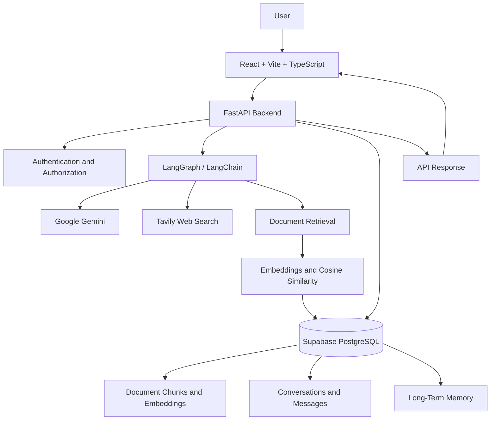

# PageTrail


Document-aware chat with retrieval, web search, and long-term memory.

**Live demo:** [https://pagetrail.onrender.com](https://pagetrail.onrender.com)

PageTrail is a FastAPI + React app. You can chat with uploaded PDFs, DOCX, TXT, and Markdown files, search the web, and keep conversation history across sessions. Application data and document embeddings live in Supabase PostgreSQL. Chat uses Google Gemini; optional web search uses Tavily.

## Features

- Sign in and keep conversations per user
- Upload documents and ask questions grounded in those files
- Web search when a question needs current information
- Long-term memory for facts the user asks the assistant to remember
- Conversation list, message history, and a production frontend served by the API

## Stack

| Layer | Technology |
| --- | --- |
| Frontend | React, Vite, TypeScript |
| Backend | FastAPI, LangGraph, LangChain |
| Models | Google Gemini |
| Database | Supabase PostgreSQL |
| Search | Tavily (optional) |
| Local extras | Redis (optional supporting service) |
| Hosted app | [Render](https://pagetrail.onrender.com) |

The project does not require the PostgreSQL `vector` extension. Embeddings are stored as JSON and ranked with cosine similarity in the backend.

## Project layout

```text
backend/app/           FastAPI application package
  api/routes/          Auth, chat, and health routes
  core/                Settings and filesystem paths
  db/                  SQLAlchemy models and session helpers
  schemas/             Pydantic request and response models
  services/            LangGraph agent, RAG, and tools
frontend/              React + Vite client
notebooks/             Exploratory notebooks
```

The Docker image copies `backend/` and the built `frontend/dist` into the container and starts `uvicorn app.main:app`.
=======
**Document-aware AI chat with retrieval, web search, and long-term memory.**

<div align="center">

[](https://pagetrail.onrender.com)
[](https://www.python.org/)
[](https://react.dev/)
[](https://fastapi.tiangolo.com/)
[](https://supabase.com/)

**Live demo:** [pagetrail.onrender.com](https://pagetrail.onrender.com)

**Source code:** [github.com/sxb05/Pagetrail](https://github.com/sxb05/Pagetrail)

</div>

---

## 🚧 Currently Working On

- **RAG improvements:** Improving document retrieval and the quality of context supplied to the language model.
- **Backend reliability:** Refining API behavior, database connectivity, error handling, and deployment workflows.
- **Authentication and data isolation:** Strengthening user-level access controls for conversations, documents, and long-term memory.
- **Production readiness:** Improving configuration management, Docker-based development, and application reliability.

## Upcoming Improvements

- [ ] **RAG evaluation:** Measure retrieval relevance and answer faithfulness.
- [ ] **Streaming responses:** Make AI conversations more interactive.
- [ ] **Semantic caching:** Reduce redundant model calls and improve response latency.
- [ ] **Background document processing:** Improve document ingestion for larger workloads.
- [ ] **Automated testing and CI/CD:** Introduce more comprehensive tests and continuous integration.
- [ ] **Observability:** Track request latency, model usage, and retrieval performance.
- [ ] **Retrieval optimization:** Explore improvements to document chunking and similarity ranking.

*These items describe development priorities and planned improvements, not guarantees that the features are already implemented.*

---

## Overview

PageTrail is a full-stack AI application that combines document-based question answering, web search, and persistent conversational memory in one interface.

Built with **FastAPI, React, TypeScript, LangGraph, LangChain, Google Gemini, and Supabase PostgreSQL**, PageTrail allows users to interact with their documents, retrieve relevant information, and continue conversations across sessions.

Instead of relying exclusively on a language model's existing knowledge, PageTrail can retrieve relevant document content and use web search when additional information is needed.

The application supports user authentication, conversation history, document retrieval, and long-term memory for facts users ask the assistant to remember.

## Features

- **Document-aware chat:** Ask questions about uploaded PDF, DOCX, TXT, and Markdown files.
- **Retrieval-Augmented Generation (RAG):** Retrieve relevant document chunks and include them in the model's context.
- **Web search:** Use Tavily to retrieve online information when web search is enabled.
- **Long-term memory:** Persist facts users explicitly ask the assistant to remember.
- **User authentication:** Sign in and maintain user-specific conversations.
- **Conversation history:** Access previous conversations and messages across sessions.
- **Persistent storage:** Store application data and document embeddings in Supabase PostgreSQL.
- **Full-stack architecture:** Integrate a React frontend with a FastAPI backend.
- **Docker support:** Run the backend and production frontend together using Docker Compose.
- **Optional Redis:** Provide a supporting service for workflows that require it.
- **Cloud deployment:** Access the deployed application through Render.

## Tech Stack

| Layer | Technology |
|---|---|
| Frontend | React, Vite, TypeScript |
| Backend | Python, FastAPI |
| Agent orchestration | LangGraph, LangChain |
| Language model | Google Gemini |
| Database | Supabase PostgreSQL |
| Document retrieval | Embeddings, cosine similarity |
| Web search | Tavily (optional) |
| Supporting service | Redis (optional) |
| Containerization | Docker, Docker Compose |
| Deployment | Render |

### Database and retrieval design

PageTrail stores document embeddings as JSON in PostgreSQL and ranks them using cosine similarity in the backend.

The application does **not** require the PostgreSQL `vector` extension.

---

## Architecture



### Request lifecycle

1. The user submits a message through the React frontend.
2. FastAPI receives the request and applies the relevant authentication and authorization checks.
3. The agent workflow coordinates the available model and retrieval operations.
4. Depending on the request, the application uses Gemini, document retrieval, or Tavily web search.
5. Retrieved information is incorporated into the model context where applicable.
6. The response is returned to the frontend, and conversation data is persisted in PostgreSQL.

The exact tools used depend on the question and the application's configured workflow.

---
>>>>>>> 6dd1620a52474d35c088046b83395927a3f7f17e

## Requirements

Before running PageTrail locally, make sure you have:

- Python 3.11 or newer
- Node.js and npm
- A Supabase project with PostgreSQL enabled
- A Google Gemini API key
- A Tavily API key if web search is enabled
- Docker and Docker Compose for containerized execution

Redis is optional unless required by the functionality you are running.

---

## Installation

<<<<<<< HEAD
**Supabase Dashboard → Project Settings → Database → Connection string → URI → Session pooler**
=======
### 1. Clone the repository
>>>>>>> 6dd1620a52474d35c088046b83395927a3f7f17e

```bash
git clone https://github.com/sxb05/Pagetrail.git
cd Pagetrail
```

### 2. Install backend dependencies

If you use the existing Conda environment:

```powershell
conda activate multi-agents
pip install -r requirements.txt
```

Alternatively, create a virtual environment.

**Windows PowerShell**

```powershell
python -m venv .venv
.venv\Scripts\Activate.ps1
pip install -r requirements.txt
```

**Linux/macOS**

```bash
python3 -m venv .venv
source .venv/bin/activate
pip install -r requirements.txt
```

### 3. Install frontend dependencies

From the repository root:

```powershell
npm --prefix .\frontend install
```

---

## Environment Configuration

Create a `.env` file in the repository root. **Never commit this file to GitHub.**

Obtain your PostgreSQL connection URI from:

**Supabase Dashboard → Project Settings → Database → Connection string → URI → Session pooler**

Configure the following variables using your own credentials:

```dotenv
DATABASE_URL=postgresql://postgres.<project-ref>:<password>@aws-0-<region>.pooler.supabase.com:5432/postgres

GEMINI_API_KEY=your-gemini-api-key
TAVILY_API_KEY=your-tavily-api-key

SUPABASE_URL=https://<project-ref>.supabase.co
SUPABASE_PUBLISHABLE_KEY=your-publishable-key
SUPABASE_SECRET_KEY=your-secret-key
SUPABASE_JWKS_URL=https://<project-ref>.supabase.co/auth/v1/.well-known/jwks.json

SECRET_KEY=replace-with-a-long-random-secret
ALGORITHM=HS256
ACCESS_TOKEN_EXPIRE_MINUTES=30
```

<<<<<<< HEAD
`DATABASE_URL` is preferred. The legacy `DATABASE_HOST`, `DATABASE_PORT`, `DATABASE_NAME`, `DATABASE_USERNAME`, and `DATABASE_PASSWORD` variables remain supported as a local PostgreSQL fallback.

If the database password contains special characters, use the exact URI copied from Supabase or URL-encode the password.

For a hosted deployment (for example Render), set the same variables in the service environment. The Docker image listens on port `8000`.
=======
**Important:** These are example values. Use the exact variable names expected by your application's configuration. Do not commit actual credentials.

| Variable | Purpose |
|---|---|
| `DATABASE_URL` | PostgreSQL database connection |
| `GEMINI_API_KEY` | Authentication for Google Gemini |
| `TAVILY_API_KEY` | Enables Tavily web search |
| `SUPABASE_URL` | Supabase project URL |
| `SUPABASE_PUBLISHABLE_KEY` | Supabase publishable key, where used |
| `SUPABASE_SECRET_KEY` | Server-side Supabase secret, where used |
| `SUPABASE_JWKS_URL` | JSON Web Key Set endpoint, where used |
| `SECRET_KEY` | Application signing secret, where used |
| `ALGORITHM` | Token signing algorithm, where used |
| `ACCESS_TOKEN_EXPIRE_MINUTES` | Token expiration configuration, where used |
>>>>>>> 6dd1620a52474d35c088046b83395927a3f7f17e

The legacy database variables remain supported as a local PostgreSQL fallback:

<<<<<<< HEAD
From PowerShell:

```powershell
conda activate multi-agents
pip install -r .\backend\requirements.txt
npm --prefix .\frontend install
=======
```dotenv
DATABASE_HOST=localhost
DATABASE_PORT=5432
DATABASE_NAME=your_database
DATABASE_USERNAME=your_username
DATABASE_PASSWORD=your_password
>>>>>>> 6dd1620a52474d35c088046b83395927a3f7f17e
```

Use `DATABASE_URL` when connecting to Supabase.

If the database password contains special characters, copy the connection URI directly from Supabase or URL-encode the password correctly.

**Security:** Never expose `SUPABASE_SECRET_KEY`, database credentials, or `SECRET_KEY` in frontend code.

<<<<<<< HEAD
Row-level security is enabled on all public application tables. The FastAPI backend connects using the database URL and performs application authorization checks.
=======
---
>>>>>>> 6dd1620a52474d35c088046b83395927a3f7f17e

## 🗄️ Database Setup

<<<<<<< HEAD
### Docker

Docker runs the API and the built React frontend together:

- `app`: FastAPI backend serving `frontend/dist`
- `redis`: Redis supporting service
- Supabase PostgreSQL: external database via `DATABASE_URL`

Make sure `.env` exists in the repository root before starting Compose. It is passed to the application container and is not copied into the image.
=======
The application creates the required tables on startup.

| Table | Purpose |
|---|---|
| `users` | User-related application data |
| `conversations` | Conversation records |
| `chat_messages` | Conversation messages |
| `long_term_memory` | Persisted user-requested memories |
| `rag_documents` | Document chunks and embeddings |

The database is hosted on Supabase PostgreSQL.

Row-level security is enabled on the public application tables. The backend also performs application-level authorization checks.

Correct user isolation depends on the actual database policies and backend authorization logic. Both should be maintained and tested.

---

## 🐳 Running with Docker Compose

Docker Compose runs the FastAPI backend and the built React frontend together.

The expected services are:

- **`app`:** FastAPI backend serving the production frontend from `frontend/dist`.
- **`redis`:** Optional supporting service.
- **Supabase PostgreSQL:** External database accessed through `DATABASE_URL`.

Ensure the root `.env` file exists before starting the application.

Build and start the services:
>>>>>>> 6dd1620a52474d35c088046b83395927a3f7f17e

```powershell
docker compose up --build -d
docker compose logs -f app
```

<<<<<<< HEAD
Open [http://localhost:8000](http://localhost:8000).
=======
Open the application:

**http://localhost:8000**

Stop the containers:
>>>>>>> 6dd1620a52474d35c088046b83395927a3f7f17e

```powershell
docker compose down
```

<<<<<<< HEAD
The database remains in Supabase when containers are stopped. Do not add a local PostgreSQL container unless you want a separate database from Supabase.
=======
Stopping the containers does not delete data stored in Supabase PostgreSQL.
>>>>>>> 6dd1620a52474d35c088046b83395927a3f7f17e

You do not need a local PostgreSQL container when using the configured Supabase database.

<<<<<<< HEAD
Start Redis if it is needed:
=======
---

## 💻 Local Development

### Start Redis (optional)

If Redis is required by your development workflow:
>>>>>>> 6dd1620a52474d35c088046b83395927a3f7f17e

```powershell
docker compose up -d redis
```

<<<<<<< HEAD
Backend:
=======
### Start the backend

From the repository root:
>>>>>>> 6dd1620a52474d35c088046b83395927a3f7f17e

```powershell
conda activate multi-agents
uvicorn app.main:app --reload --app-dir backend
```

<<<<<<< HEAD
Frontend:
=======
The backend will be available at:

**http://127.0.0.1:8000**

### Start the frontend

Open a separate terminal and run:
>>>>>>> 6dd1620a52474d35c088046b83395927a3f7f17e

```powershell
npm --prefix .\frontend run dev
```

<<<<<<< HEAD
The backend runs at `http://127.0.0.1:8000` and the frontend at `http://localhost:5173`.

Production frontend build:
=======
The Vite development server will typically be available at:

**http://localhost:5173**

### Build the production frontend
>>>>>>> 6dd1620a52474d35c088046b83395927a3f7f17e

```powershell
npm --prefix .\frontend run build
```

The production frontend is generated in `frontend/dist`. When that directory exists, the backend serves the built frontend according to the application's static-file configuration.

---

<<<<<<< HEAD
1. Select a PDF, DOCX, TXT, or Markdown file in the composer.
2. The file is staged locally and is not uploaded immediately.
3. Press **Send**.
4. The backend uploads and extracts the file.
5. Text is split into chunks and embeddings are stored in `public.rag_documents`.
6. Relevant chunks for the current conversation are retrieved from PostgreSQL and included in the LLM context.
=======
## Document RAG Workflow

PageTrail supports document-based question answering through a retrieval pipeline.
>>>>>>> 6dd1620a52474d35c088046b83395927a3f7f17e

1. Select a PDF, DOCX, TXT, or Markdown file in the chat composer.
2. The selected file is staged locally rather than immediately uploaded.
3. Press **Send** to submit the message and selected file.
4. The backend receives the file and extracts its text.
5. The extracted content is split into smaller chunks.
6. Embeddings are generated and stored in `public.rag_documents`.
7. Relevant chunks are retrieved using cosine similarity.
8. The retrieved context is included in the language model request to help generate a grounded answer.

The retrieval pipeline uses PostgreSQL for persistence and backend-side similarity ranking rather than requiring the PostgreSQL `vector` extension.

---

## ✅ Useful Checks

### Health endpoint

Local:

```http
GET http://127.0.0.1:8000/api/health
```

<<<<<<< HEAD
On the live deployment:
=======
Production:

```http
GET https://pagetrail.onrender.com/api/health
```

### Check database connectivity
>>>>>>> 6dd1620a52474d35c088046b83395927a3f7f17e

```text
GET https://pagetrail.onrender.com/api/health
```

<<<<<<< HEAD
Database connection:

```powershell
python -m app.db.session
```

Run that command from the `backend` directory so Python can import the `app` package.

Frontend build:
=======
### Verify the frontend build
>>>>>>> 6dd1620a52474d35c088046b83395927a3f7f17e

```powershell
npm --prefix .\frontend run build
```

### Troubleshoot deployment

If the deployed application fails to start or database-dependent requests fail:

1. Check the Render application logs.
2. Verify that the production environment variables are configured.
3. Confirm that Supabase PostgreSQL is reachable from the deployment.
4. Check the database connection URI and credentials.
5. Verify that the required tables are initialized.
6. Confirm that the frontend production build exists and is served correctly.

---

## ☁️ Deployment

PageTrail is deployed on Render.

**Live demo:** [https://pagetrail.onrender.com](https://pagetrail.onrender.com)

To deploy your own instance:

1. Push the project to a GitHub repository.
2. Create a Render Web Service connected to the repository.
3. Configure the appropriate build and start commands, or deploy using the existing Docker configuration.
4. Add the required environment variables through Render's service settings.
5. Configure the Supabase PostgreSQL connection.
6. Ensure the application listens on the expected port (`8000` in the provided Docker setup).
7. Deploy and verify the health endpoint.

Keep production credentials in Render's environment-variable settings rather than in the repository.

---

## 🛡️ Security Considerations

- Never commit `.env` files or production credentials.
- Never expose `SUPABASE_SECRET_KEY` in frontend code.
- Keep database and API credentials private.
- Rotate credentials immediately if they have been exposed.
- Enforce user-level authorization for conversations, documents, and long-term memory.
- Validate uploaded files and enforce appropriate size limits.
- Verify Supabase row-level security policies alongside backend authorization.
- Use HTTPS for production traffic.
- Avoid logging secrets, authentication tokens, or sensitive document contents.

---

## Future Improvements

Potential directions for further development include:

- Automated RAG evaluation for retrieval relevance and answer faithfulness.
- Streaming responses for a more interactive chat experience.
- Semantic caching to reduce redundant model calls.
- Background document ingestion for larger files and workloads.
- Improved observability for latency, token usage, and tool execution.
- Automated testing and continuous integration.
- More granular document permissions and retrieval controls.

---

## What This Project Demonstrates

PageTrail brings together several practical AI and software engineering concepts:

- Agent orchestration with LangGraph and LangChain.
- Retrieval-Augmented Generation and document processing.
- Integration with external language models and web search tools.
- Persistent conversational state and relational data modeling.
- Authentication and authorization in a full-stack application.
- REST API development with FastAPI.
- React and TypeScript frontend development.
- Docker-based deployment and cloud-hosted PostgreSQL.

The project explores how an AI application can combine language models with retrieved knowledge, persistent state, and external tools in a deployable full-stack system.

---

## 👨‍💻 Author

**Subash Balaji**

- GitHub: [@sxb05](https://github.com/sxb05)
- Repository: [Pagetrail](https://github.com/sxb05/Pagetrail)
- Live application: [pagetrail.onrender.com](https://pagetrail.onrender.com)

---

If you find PageTrail interesting, try the live demo or explore the source code.

- Do not commit `.env`.
- Do not expose `SUPABASE_SECRET_KEY` in frontend code.
- Rotate database and API credentials if they have been shared publicly.
- Use the Supabase Session Pooler URI when the direct database hostname cannot be resolved by the local network.
=======
>>>>>>> 6dd1620a52474d35c088046b83395927a3f7f17e
